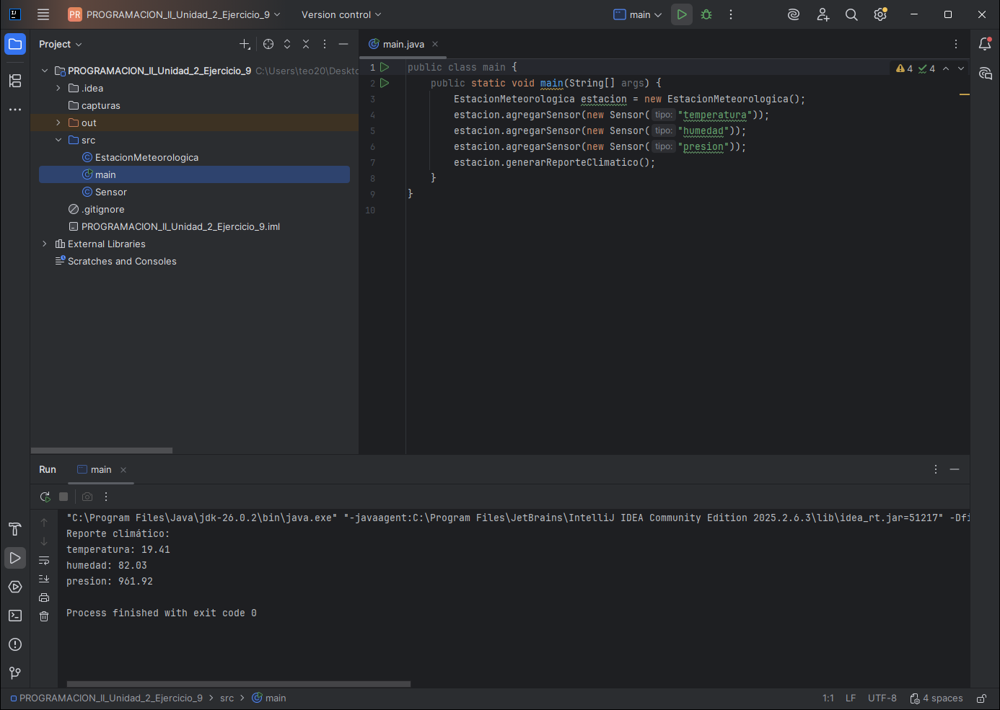

# PROGRAMACIÓN II — Unidad 2, Ejercicio 9: Estación Meteorológica y Sensores Ambientales

Trabajo práctico de Programación II. Este repositorio contiene la resolución en Java del ejercicio 9 de la Unidad 2.

## Consigna

#### Contexto

Una estación meteorológica central recopila información periódicamente de múltiples sensores distribuidos en el campo (temperatura, humedad, presión). Para lograr esto, la estación envía un mensaje de consulta a cada sensor para recolectar los datos actualizados.

#### Consigna

Desarrollar un sistema en Java donde un objeto coordinador (EstacionMeteorologica) se comunique activamente con varios objetos Sensor mediante el envío de mensajes de solicitud de lectura.

#### Desarrollo requerido

- Crear la clase Sensor con atributos como tipo (temperatura, humedad) y un método obtenerLectura() que retorne un valor numérico simulado (por ejemplo, usando un rango aleatorio).
- Desarrollar la clase EstacionMeteorologica que mantenga una lista de objetos Sensor.
- Implementar un método generarReporteClimatico() en la estación que recorra la colección de sensores y les envíe el mensaje para recolectar y consolidar los datos.
- En el método main, instanciar la estación, agregarle al menos tres sensores de distintos tipos y ejecutar la generación del reporte imprimiendo los resultados por consola.

## Estructura del repositorio

```
PROGRAMACION_II_Unidad_2_Ejercicio_9/
├── README.md
├── capturas/
│   └── consola.png
└── src/
    ├── EstacionMeteorologica.java
    ├── main.java   # clase con el método main
    └── Sensor.java
```

## Funcionamiento y lógica

El ejercicio modela una estación meteorológica que le pide datos a varios sensores y arma un reporte con sus respuestas.

### `Sensor`

Tiene un `tipo` (temperatura, humedad o presión). Su método `obtenerLectura()` genera un valor con `Random` según el tipo:

- **temperatura:** entre 10 y 35.
- **humedad:** entre 30 y 90.
- **presión:** entre 950 y 1050.

### `EstacionMeteorologica`

Guarda una lista (`ArrayList`) de sensores.

- **`agregarSensor(Sensor)`:** suma un sensor a la estación.
- **`generarReporteClimatico()`:** recorre la lista, le pide la lectura a cada sensor y la imprime con dos decimales usando `printf`.

### `main`

Crea la estación, le agrega un sensor de cada tipo y genera el reporte climático.

Como las lecturas son aleatorias, los valores cambian en cada ejecución. Por eso los números de la captura no son los mismos que los de la salida de texto de abajo.

## Ejecución

Captura de la consola de IntelliJ IDEA ejecutando el programa:



Salida obtenida:

```
Reporte climático:
temperatura: 26.89
humedad: 85.67
presion: 976.46
```
